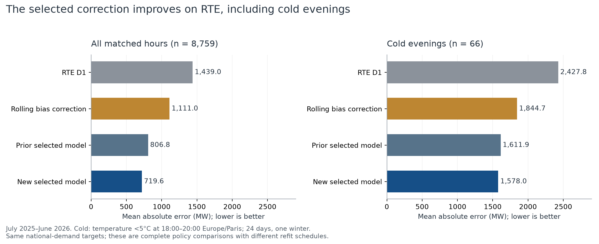
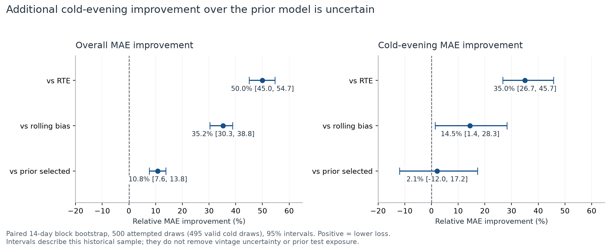
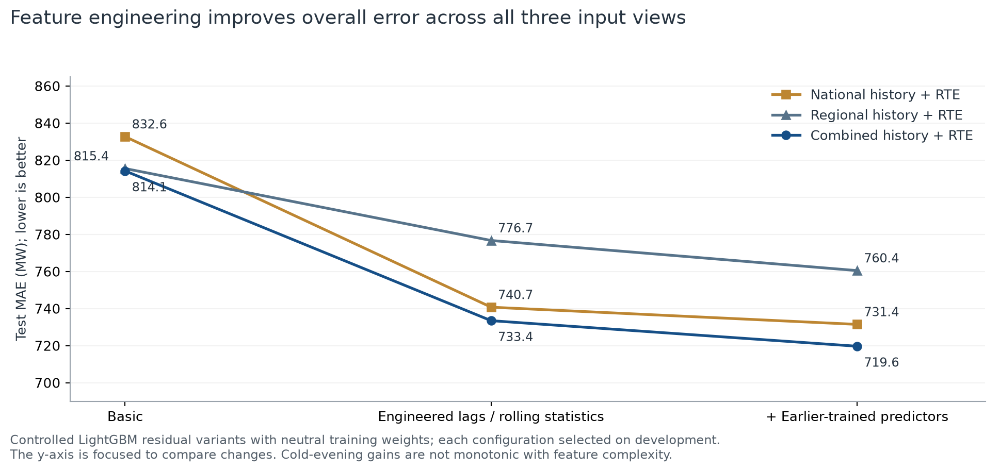
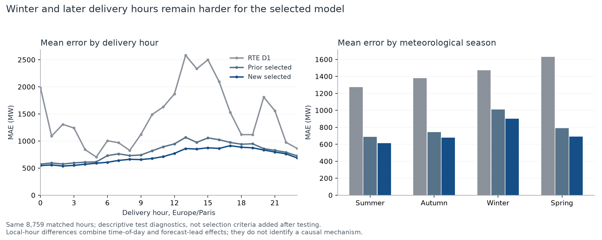
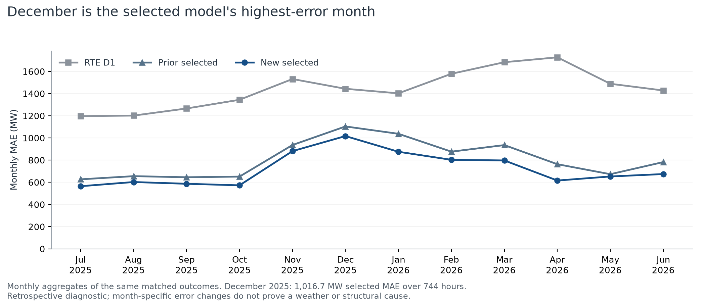
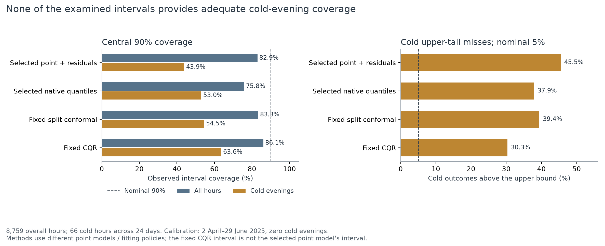
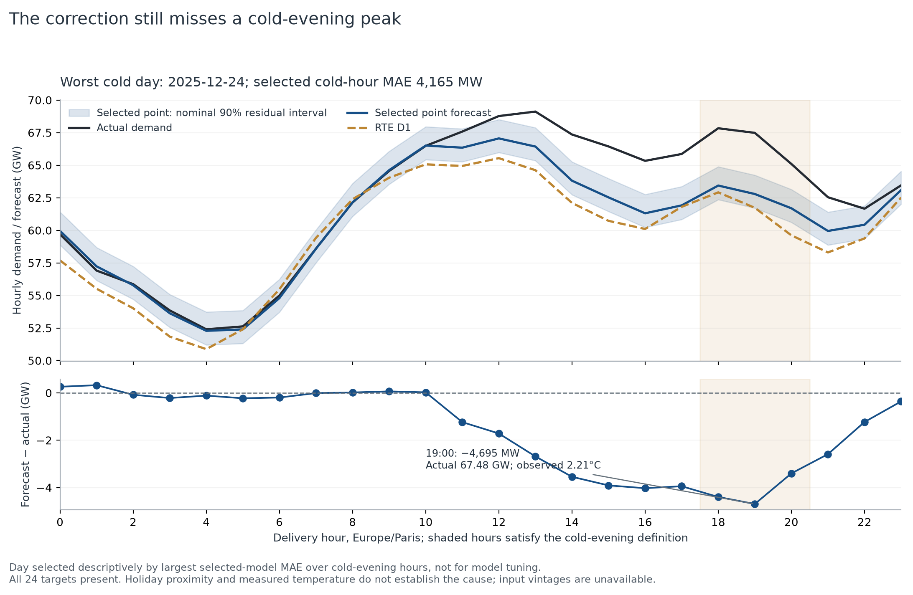
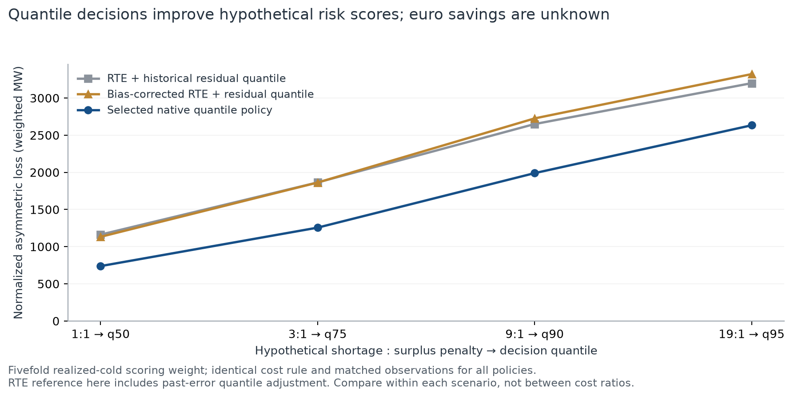

# RTE correction halves historical forecast error, but cold-peak uncertainty remains inadequate

**Decision report for the head of trading — 21 October 2026**  
**Evaluation:** French national hourly consumption, 1 July 2025–30 June 2026.  
**Evidence:** frozen research run `20261020T213640021260Z`; 8,759 matched nonmissing hourly outcomes.

## Executive summary

1. **Can we improve on RTE? Yes, in this retrospective study.** The development-selected LightGBM correction reduces mean absolute error (MAE) from **1,438.98 MW to 719.63 MW**, a **49.99% improvement**. A paired 14-day-block bootstrap gives a 95% improvement interval of **45.02%–54.65%**. It also improves on simple rolling RTE bias correction by **35.23%** and the previous selected RTE-assisted policy by **10.80%**.
2. **Is the uncertainty adequate for expensive cold-evening errors? No.** Cold-evening MAE improves by **35.00% versus RTE**, but the selected point forecast still underpredicts **51 of 66 critical hours**. Nominal 90% interval coverage is only **43.94%** for its empirical residual interval, **53.03%** for the separate selected quantile model, and **63.64%** for a fixed CQR comparator. Calibration contains **zero cold-evening observations**.
3. **What should be deployed? No procurement replacement is justified by this experiment alone.** Retain the selected correction as the research candidate for a new, unseen, vintage-correct evaluation and subsequent shadow comparison. Keep the current operating process unchanged until those conditions are met. Do not use these intervals as evidence for reliable cold-evening reserve sizing. This report recommends research and decision gates; it does not implement production systems.

The numerical improvement is substantial, but historical RTE availability is assumed, the test period had already been inspected, and national consumption is a proxy for the utility's customer portfolio. These restrictions limit the conclusion to the stated historical experiment.

## 1. Can we do better than RTE, and by how much?

### The selected model learns a correction to RTE

The point forecast is **RTE D1 plus a LightGBM estimate of its error**. The correction target is actual national demand minus the supplied RTE forecast. Available calendar information, national and regional demand/weather histories, eligible lags, rolling statistics, historical RTE errors, and earlier-trained regression/classification outputs inform that correction.

The selected policy is `lab__lightgbm__combined__stacked__w1__residual`. Here, “stacked” means additional causal learned predictors: a Ridge demand forecast and cold/underprediction probabilities. **This winner is not an ensemble of all 13 original architectures.** Its base-architecture field is null.

It forecasts from **11:00 Europe/Paris on D** for all actual hourly intervals of D+1, including 23- and 25-hour daylight-saving days. The whole D+1 RTE D1 profile is assumed available at that origin. The next-but-one-day product and its 05:00 schedule are excluded.

### Matched historical results

| Complete forecasting policy | Overall MAE, MW | RMSE, MW | Cold-weighted MAE, MW | Cold-evening MAE, MW |
|---|---:|---:|---:|---:|
| Supplied RTE D1 | 1,438.98 | 1,782.65 | 1,467.91 | 2,427.77 |
| Rolling RTE bias correction | 1,111.05 | 1,412.84 | 1,132.51 | 1,844.66 |
| Previous selected RTE-assisted policy | 806.76 | 1,048.74 | 830.32 | 1,611.93 |
| **New development-selected correction** | **719.63** | **948.61** | **744.75** | **1,578.02** |

**Interpretation.** The correction removes 719.35 MW of average absolute error relative to RTE. The additional gain over rolling bias correction shows value beyond merely recentering RTE. Against the previous selected ML policy, it removes a further 87.13 MW. These are comparisons between complete forecasting policies: the new models refit quarterly, while earlier reference policies retain monthly schedules. The entire gain cannot be attributed solely to the new features.

Cold-weighted MAE assigns weight five to realized temperature below 5°C at local hours 18, 19 or 20, and weight one otherwise. Despite that penalty, the 66 critical hours contribute only **3.66% of the weighted denominator**. A favorable aggregate score therefore cannot replace a separate cold-evening assessment.

Sources: [matched scorecard](../rte_risk/20261020T213640021260Z/tables/test_scorecard.csv), [frozen selection](../rte_risk/20261020T213640021260Z/frozen_selection.json).

### How certain is the measured improvement?

| Reference | Overall MAE improvement | 95% block interval | Cold-evening MAE improvement | 95% block interval |
|---|---:|---:|---:|---:|
| RTE D1 | 49.99% | 45.02% to 54.65% | 35.00% | 26.71% to 45.71% |
| Rolling RTE bias correction | 35.23% | 30.33% to 38.80% | 14.45% | 1.39% to 28.28% |
| Previous selected model | 10.80% | 7.65% to 13.79% | 2.10% | −12.01% to 17.22% |

The new model's additional cold-evening gain over the previous model is **33.92 MW**, with a 95% interval of **−219.58 to +238.29 MW**. That interval includes regression as well as improvement; it also crosses zero with 7- and 28-day blocks. **Incremental cold superiority over the previous model is not established.**

The analysis pairs model losses on the same observations and resamples contiguous forecast-day blocks, preserving some temporal dependence. The reported intervals use 500 attempted resamples and 14-day blocks, with 7-/28-day sensitivity checks. Overall comparisons retain all 500 draws; cold-only 14-day comparisons retain 495 draws containing critical observations. They quantify sampling uncertainty within this historical dataset. They do not correct for previously inspecting the test period, unknown original forecast vintages, or future regime changes. Source: [paired comparisons](../rte_risk/20261020T213640021260Z/tables/bootstrap.csv).

### Do the regional data and engineered features help?

All three input views predict the same national-demand target. “Regional-only” means regional histories plus national RTE and calendar; it is not a sum of regional targets or a regional RTE product.

| LightGBM input view, neutral training weights | Basic features: MAE, MW | Engineered features: MAE, MW | Plus learned predictors: MAE, MW |
|---|---:|---:|---:|
| National history + RTE | 832.64 | 740.69 | 731.42 |
| Regional history + RTE | 815.44 | 776.65 | 760.41 |
| Combined history + RTE | 814.15 | 733.42 | **719.63** |

Engineered history improves overall accuracy across the three views. Combining national and regional history gives the strongest overall result within these neutral-weight variants. The more complex feature set does **not** improve every critical-segment metric monotonically. For example, national engineered features have cold MAE 1,519.54 MW, while adding learned predictors gives 1,594.62 MW. This is descriptive evidence from controlled variants, not proof that every added feature is useful in every regime. Source: [feature ablation](../rte_risk/20261020T213640021260Z/tables/feature_ablation.csv).

### Breadth of comparison and limits of model ranking

The final scorecard contains **98 policy/variant labels**, not 98 independent algorithms: 27 original policies, 16 earlier RTE-assisted variants, and 55 new variants. The expansion comprises 30 tabular variants, 23 base-model-plus-LightGBM hybrids covering 13 original family labels, and two hybrid controls. The families span statistical, boosting, GAM, and neural approaches, including ARIMA/SARIMA/SARIMAX, N-BEATS, NHiTS, TFT, GRU, PatchTST and DLinear.

The hybrids use causal out-of-sample base predictions. They do not establish that every architecture was retrained natively with RTE features. Earlier compact neural training budgets and training-anchor limitations persist. Some variant labels yield identical point predictions. Eleven of 23 hybrids improve weighted test loss over their matched control, a descriptive result that does not establish general architecture superiority.

The report retains the **development-selected point model**, even though some other variants have slightly lower retrospective test errors. Selecting a different winner after inspecting those errors would require another unseen evaluation. Full results are available in the [98-policy scorecard](../rte_risk/20261020T213640021260Z/tables/test_scorecard.csv) and [hybrid control comparison](../rte_risk/20261020T213640021260Z/tables/hybrid_control_comparison.csv).

## 2. How uncertain is the forecast, and when does it fail?

### Overall accuracy conceals persistent cold-evening underprediction

The selected point forecast has almost zero overall signed bias: **+7.00 MW**, using forecast minus actual. Its cold-evening bias is **−1,089.65 MW**. It underpredicts **51/66 cold hours (77.27%)**, with average shortage of **1,333.83 MW across all critical hours**, or **1,726.14 MW conditional on an underforecast**.

Cold-evening MAE is 1,578.02 MW versus 713.11 MW outside that segment. Critical support is limited to **66 hours across 24 days and one represented DJF winter**. These dependent hours do not provide 66 independent winter events.

Winter MAE is **901.33 MW**, compared with **612.93 MW in summer**. The largest local-hour average error is **913.37 MW at 17:00**, versus 537.34 MW at 02:00. Time-of-day and forecast-lead effects coexist; this grouping cannot separate their causes. Later delivery intervals with leads above 24 hours have MAE **830.58 MW**, versus **608.66 MW** for leads up to 24 hours.

December 2025 has the highest selected-model monthly MAE, **1,016.69 MW across 744 hours**. These plots describe failure conditions; they do not establish that weather forecast errors caused them. Sources: [saved segment scores](../rte_risk/20261020T213640021260Z/tables/test_segments.csv), [new descriptive diagnostics](diagnostics/findings.md).

### Nominal 90% does not mean observed 90%

The uncertainty study evaluates multiple distinct constructions. The selected point model's residual interval, the separately selected quantile model, and fixed engineered-model conformal comparisons must not be treated as interchangeable intervals around one point forecast.

| Central 90% interval method | Overall coverage | Cold coverage | Mean cold width, MW | Cold upper misses |
|---|---:|---:|---:|---:|
| Selected point + past out-of-sample residuals | 82.91% | 43.94% | 2,528.16 | 30/66 (45.45%) |
| Selected native quantile LightGBM | 75.82% | 53.03% | 3,319.59 | 25/66 (37.88%) |
| Fixed engineered native quantiles | 72.74% | 54.55% | 3,160.66 | 23/66 (34.85%) |
| Fixed split conformal | 83.32% | 54.55% | 2,586.36 | 26/66 (39.39%) |
| Fixed conformalized quantile regression (CQR) | 86.08% | 63.64% | 3,875.55 | 20/66 (30.30%) |

A calibrated central 90% interval targets 5% misses above its upper endpoint. Actual cold upper-miss rates of **30%–45%** are materially larger. The native model's cold upper misses exceed the upper bound by an average **1,145.51 MW conditional on a miss**.

The asymmetric q7.5–q97.5 interval shifts nominal error allowance toward the lower tail, targeting 2.5% upper misses. For the selected native quantile model, cold coverage rises to **59.09%**, but **20/66 cold outcomes still exceed its upper endpoint (30.30%)**. Asymmetry alone does not repair poor calibration.

Calibration used **2,136 hours from 2 April–29 June 2025 and contained zero cold evenings**. That seasonal gap is a concrete limitation. It does not prove the entire cause of undercoverage, but it prevents a credible claim that winter-tail calibration was established. Standard conformal terminology does not supply cold-conditional coverage for a dependent, changing series. [Adaptive conformal inference research](https://arxiv.org/abs/2106.00170) studies adaptation under distribution shift; this study has not established such a guarantee for these particular intervals.

Sources: [overall uncertainty](../rte_risk/20261020T213640021260Z/tables/uncertainty_scorecard.csv), [cold intervals](../rte_risk/20261020T213640021260Z/tables/cold_interval_scorecard.csv), [calibration support](../rte_risk/20261020T213640021260Z/tables/calibration_support.csv).

### Proper scoring rules and their limits

Pinball loss evaluates a chosen quantile; WIS combines interval width and misses across selected interval levels; Winkler scores penalize both width and observations outside an interval. CRPS evaluates an entire predictive distribution. Lower is better for these reported losses. Quantile objectives can estimate medians or tails, which need not equal conditional means. [Scikit-learn's quantile regression example](https://scikit-learn.org/stable/auto_examples/ensemble/plot_gradient_boosting_quantile.html) illustrates this distinction and tail-specific tuning.

The selected point model's specified empirical residual distribution has overall CRPS **555.29 MW**, versus **816.95 MW** for RTE with the same calibration procedure. The selected native quantile model has overall WIS **472.45 MW**, better than **496.20 MW** for fixed engineered quantiles. However, their cold WIS ordering reverses: **1,109.06 versus 1,052.65 MW**. Aggregate proper-score improvements therefore do not establish adequate cold-tail protection.

The native probability arm was selected using **overall, unweighted development WIS** and point-selected hyperparameters, without a cold-interval selection guardrail. It is not established as the best cold-tail model. Exact CRPS is reported only for the explicitly constructed empirical residual distribution; the sparse native quantile grid is not mislabeled exact CRPS. Threshold-weighted CRPS is an additional upper-demand diagnostic, not a substitute for conditional coverage. CQR remains a separate calibration method, rather than another demand forecasting architecture. [CQR research](https://arxiv.org/abs/1905.03222) provides its methodological basis.

### Inspecting individual failures

The five worst selected-model days below are ranked by daily MAE over matched observations. All five have 24 observed target hours. “Under” and “over” describe the day's mean signed error, not an inferred cause.

| Day | Selected MAE, MW | RTE MAE, MW | Prior selected MAE, MW | Mean direction | Observed context |
|---|---:|---:|---:|---|---|
| 1 Dec 2025 | 2,652.29 | 3,058.38 | 1,983.38 | Under | Monday; all 24 selected forecasts below demand |
| 29 Nov 2025 | 2,268.73 | 1,011.29 | 2,027.04 | Over | Saturday; no qualifying cold-evening hours |
| 5 Jan 2026 | 2,093.96 | 2,502.58 | 2,084.30 | Under | Monday; 3 cold-evening hours |
| 1 Nov 2025 | 2,090.51 | 3,902.75 | 1,769.10 | Under | National public holiday; no qualifying cold-evening hours |
| 1 Feb 2026 | 1,999.68 | 784.08 | 1,656.06 | Over | Sunday; no qualifying cold-evening hours |

On 1 December, net daily energy was underforecast by **63,654.85 MWh**. On 29 November and 1 February, the selected model performs materially worse than RTE despite improving the annual average. Annual skill does not imply dominance on every day.

The worst day ranked specifically by **cold-evening MAE** is **24 December 2025**, at **4,165.3 MW over three cold hours**. At 19:00, demand was **67,480 MW**, the selected point forecast **62,785.26 MW**, RTE **61,725 MW**, and the prior model **63,486.99 MW**. The observed temperature was 2.21°C. The selected correction improves on RTE at that hour but still underpredicts by **4,694.74 MW** and is worse than the prior model.

Calendar proximity to Christmas and measured cold are observed conditions, not proof of a holiday-model failure or weather-forecast miss. Original weather forecast runs and RTE issue snapshots are unavailable, so causal attribution remains unresolved. Sources: [worst-day table](diagnostics/worst_five_days.csv), [worst cold-day trajectory](diagnostics/worst_cold_day_hourly.csv).

## 3. What should we deploy, and what are the risks?

### Decision

**Nominate the frozen combined-history LightGBM correction for prospective research and shadow evaluation. Do not authorize a procurement or reserve-planning replacement from these results alone.** Keep the present operating process until an experiment using authentic pre-cutoff snapshots and the actual customer portfolio demonstrates an acceptable gain and risk profile.

The model is attractive because it improves substantially on both raw RTE and simple bias correction, uses an interpretable residual construction, and avoids unnecessary architectural complexity. The justification is measured policy performance, not a claim that LightGBM is universally superior. The uncertainty component does not pass the critical-condition diagnostic.

### Conditions that would change the recommendation

| Gate | Required evidence before approval | Present status |
|---|---|---|
| Historical information availability | Archived RTE versions, weather runs if used, and demand publication/revision timestamps that precede every forecast origin | Unverified vintages; assumed cutoff rules |
| Unseen confirmation | A prospectively frozen comparison covering a meaningful winter and the actual portfolio | Current national test previously inspected |
| Cold-tail uncertainty | Winter-representative calibration; predeclared cold coverage, upper-miss severity and width requirements assessed with adequate support | Critical undercoverage; zero cold calibration hours |
| Practical policy reliability | Deadline, input freshness, missing-input and fallback behavior evaluated end to end | Historical availability is not a live reliability test |
| Financial value | Price data, applicable settlement rules, market products and one explicit procurement policy applied equally to candidates and RTE | Physical-unit risk proxies only |

These are proposed decision gates, not completed production work or a new round of test-driven tuning. Numerical acceptance tolerances for procurement and reserve risk require trading-desk cost and risk preferences; they cannot be inferred from MAE alone.

### Risk register

| Risk | Evidence / implication | Response before operational use |
|---|---|---|
| Look-ahead through revisions or RTE vintages | Correct timestamp filtering does not establish that the exact historical values existed at the origin | Archive issue time, receipt time and version; replay the same snapshot rule |
| Test reuse and model selection bias | The period was explored in earlier work; many correlated variants were compared | Freeze the current candidate and judge it on unseen outcomes |
| Cold underprediction and undercoverage | 77.27% of critical point forecasts are low; nominal 90% intervals miss much more than 10% | Revisit winter calibration and tail-specific objectives using development data; validate a fixed policy on unseen winters |
| Sparse extreme-event support | Only 24 cold test days and one winter | Report counts and uncertainty; add independent winter evidence |
| National-to-portfolio mismatch | Regional and national inputs forecast national demand, not the utility's customer mix | Separate portfolio-level validation and reconciliation |
| Missing or stale inputs | Historical raw forecast availability is 99.99%, but this is not an ingestion/deadline availability measurement | Evaluate stale data, absent RTE and missing-history scenarios; document safe fallback/escalation |
| Regime change and fitting instability | Winter errors and development train–validation gaps remain larger | Monitor performance by regime; predeclare retraining/calibration updates before evaluation |
| Unproven financial value | MW penalties are hypothetical; settlement prices and procurement policy are absent | Use forecast skill and labeled physical risk proxies until a fair economic replay exists |

### Forecasting and purchasing are separate decisions

The selected point model uses an absolute-error objective, associated with a conditional median under that loss. Buying a quantity requires shortage and surplus costs. In a simplified asymmetric linear-loss scenario, the optimal decision quantile is `shortage_cost / (shortage_cost + surplus_cost)`. The study evaluates ratios 1:1, 3:1, 9:1 and 19:1 through q50, q75, q90 and q95 decisions on every interval; realized future cold is not an operational decision trigger.

The native quantile policy improves the saved hypothetical risk scores relative to residual-adjusted RTE under the same rules. Those comparisons use **weighted MW**, not euros. They do not establish procurement savings, and poor tail calibration remains a material concern. Comparing score magnitudes across different cost ratios is also inappropriate because the loss function changes. Source: [quantile decision scenarios](../rte_risk/20261020T213640021260Z/tables/quantile_decision_risk_scenarios.csv).

Separate hourly intervals are not a probability interval for total daily energy, the daily maximum, or reserve requirements for the whole trajectory. Those quantities require joint cross-hour uncertainty and a separately evaluated decision rule. The expanded run does not establish those guarantees.

## Methods and reproducibility

### Chronology and availability

| Stage | Period | Purpose / support |
|---|---|---|
| Base-model burn-in | Q1 2024 | Generate causal base forecasts for later hybrids |
| Development | Q2–Q4 2024; 2 Jan–31 Mar 2025 | Four chronological folds; 8,735 scored hours; 102 cold hours across 41 days |
| Separate calibration | 2 Apr–29 Jun 2025 | 2,136 hours; zero cold evenings |
| Retrospective test | 1 Jul 2025–30 Jun 2026 | 8,759 scored hours; 66 cold hours across 24 days |

Training uses only labels released before the relevant fit; demand/weather history uses an assumed interval-end-plus-two-hour publication delay, strictly before the origin. Target-minus-24-hour observations are masked whenever they would not yet be available. Future realized delivery-day weather is excluded from predictors. Calendar features and the RTE profile are assumed known; observed cold labels are used retrospectively for segment scoring. These practices follow the principle of training only on earlier information in [forecasting cross-validation guidance](https://otexts.com/fpp3/toolbox.html#time-series-cross-validation).

All evaluation target gaps remain missing. The one missing target at **26 October 2025 00:00 UTC** is reported and excluded from hourly scores; the full delivery grid is retained. For the additional daily diagnostics, complete-day energy/peak metrics are withheld for that incomplete 25-hour local day. Genuine demand peaks remain included.

Demand and forecast units are supplied hourly MW. For a one-hour interval, multiplying mean MW by one hour gives MWh. Original source aggregation and historical revision conventions remain evidence limitations; the report does not establish their provenance merely from timestamp equality.

### Selection, tuning and overfitting

The expansion evaluates two declared regularization/complexity configurations per variant across four chronological folds: **440 configuration-fold comparisons**, plus probability replays. Selection minimizes normalized cold-weighted MAE subject to raw availability, ordinary-MAE and cold-MAE guardrails against rolling bias correction, and minimum critical support.

The selected point policy uses 200 estimators, 31 leaves, a minimum of 144 samples per leaf, L2 regularization 20, learning rate 0.05, and ordinary training weights. The cold-weighted selection score still emphasizes critical hours. Learned feature generators follow their fixed monthly schedule; new candidate models refit quarterly, incorporating earlier outcomes only after release.

The selected policy's sampled training MAE ranges from **268.52 to 435.16 MW** across folds; subsequent fold MAE ranges from **527.36 to 1,008.58 MW**. This gap can reflect fitting and temporal shift; it is not a formal bias–variance decomposition or proof that overfitting is absent. Bounded tuning and regularization reduce some risks but do not certify generalization. The [development fit diagnostics](../rte_risk/20261020T213640021260Z/tables/development_fit_gaps.csv) preserve those differences.

### Metric definitions

- **MAE:** average absolute hourly forecast error; primary readable point-accuracy measure.
- **RMSE:** square root of average squared error; emphasizes larger errors.
- **Signed bias:** this report uses forecast minus actual; negative means underforecast. The saved scorecard uses the opposite sign in its explicitly named bias column.
- **Cold-weighted MAE:** `sum(weight × absolute_error) / sum(weight)`; weight five on the defined realized cold evenings, one otherwise.
- **Relative improvement:** `100 × (1 − candidate_loss / reference_loss)` on identical eligible observations. Positive means improvement.
- **Coverage / width / exceedance:** frequency inside an interval, mean interval width, and directional misses; none alone describes interval quality.
- **Energy and shortage proxies:** hourly MW multiplied by interval duration, aggregated in MWh; not monetary savings.

### Verification and supporting files

The existing experiment passed **123 tests**, with one optional skip. Its artifact audit checked **662 sealed forecast files, 1,927,344 rows, 80,306 daily-origin records and 851 fit events**, with zero fit-execution failures. Independent review passed **505 numerical comparisons**. These checks validate recorded calculations and provenance consistency, not unavailable historical vintages or future performance.

This report adds descriptive failure diagnostics and chart exports from the frozen forecasts. It does not refit, retune or change the selected model. The report's critical claims were independently audited in [claim_audit.md](claim_audit.md).

- [Frozen evaluation specification](../../config/rte_risk_experiment.json)
- [Full matched point scorecard](../rte_risk/20261020T213640021260Z/tables/test_scorecard.csv)
- [Paired block-bootstrap results](../rte_risk/20261020T213640021260Z/tables/bootstrap.csv)
- [Feature definitions and availability](../rte_risk/20261020T213640021260Z/tables/feature_register.csv)
- [Uncertainty scorecard](../rte_risk/20261020T213640021260Z/tables/uncertainty_scorecard.csv)
- [Independent numerical review](../rte_risk/20261020T213640021260Z/independent_result_review.md)
- [Artifact verification](../rte_risk/20261020T213640021260Z/artifact_verification.json)
- [Reproduce additional failure diagnostics](diagnostics/build_diagnostics.py)
- [Reproduce standalone figures](render_research_figures.py)
- [Figure source hashes](figure_provenance.json)

**Final recommendation:** preserve the measured historical gain, advance the frozen correction to a credible unseen research comparison, and treat cold-tail uncertainty as an unresolved approval blocker for procurement and reserve decisions.
